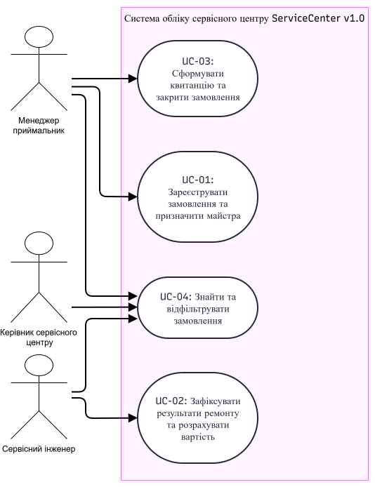
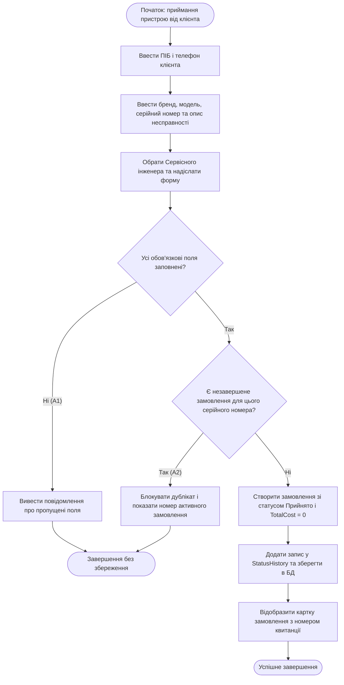
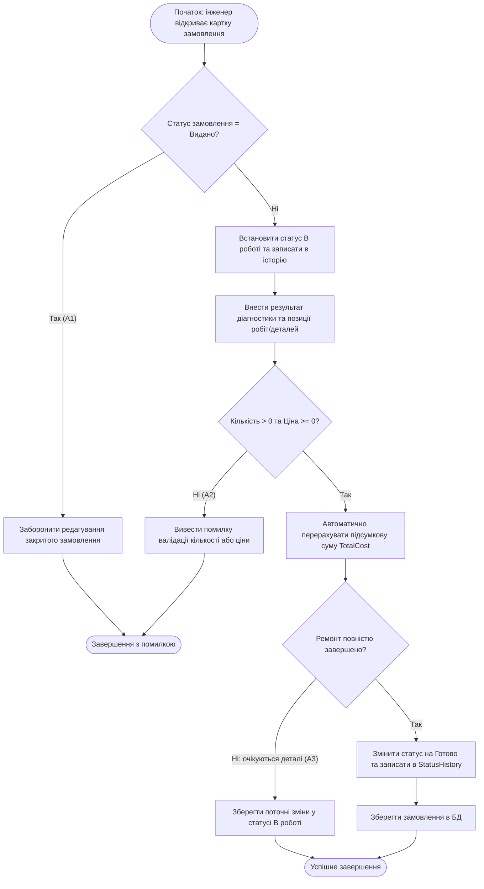
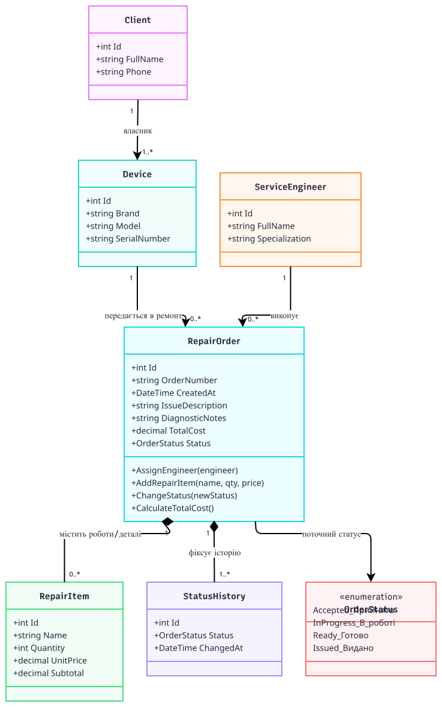
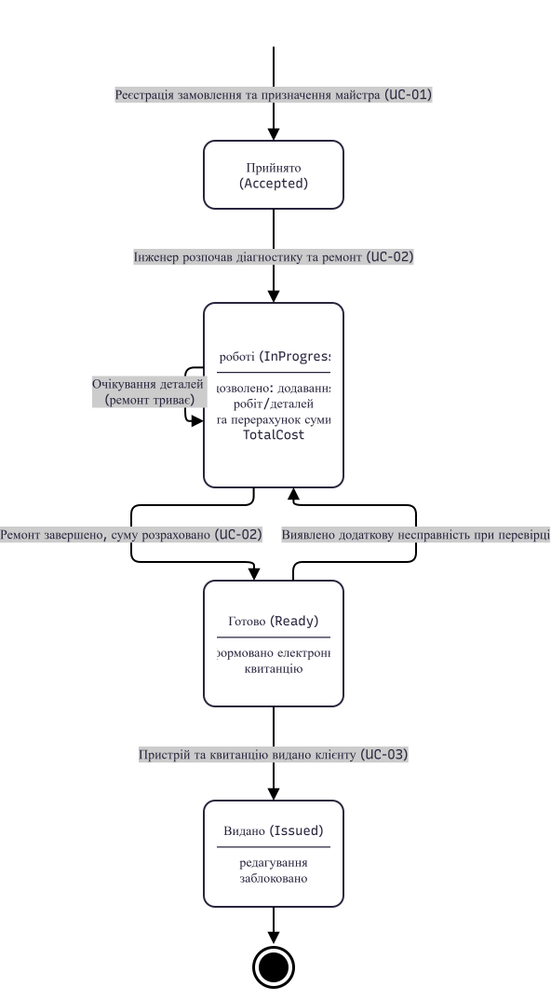

# Проєктування версії v1.0 (`ServiceCenter`)

## 1. Діаграма варіантів використання (Use Case Diagram)

**Інженерне питання:** Хто взаємодіє із системою обліку сервісного центру у версії v1.0 і яких цілей досягає?  
**Пов'язані вимоги:** FR-01, FR-02, FR-03, FR-04, FR-05.

На діаграмі показано межу системи `ServiceCenter v1.0` та трьох акторів, виділених під час аналізу проблем у ЛР №1:
- **Менеджер-приймальник** — реєструє замовлення, призначає майстра (UC-01), видає готову техніку з формуванням електронної квитанції (UC-03) та шукає замовлення за запитом клієнта (UC-04).
- **Сервісний інженер** — переглядає призначені задачі (UC-04), проводить діагностику, додає виконані роботи/запчастини та змінює статус на «В роботі» / «Готово» (UC-02).
- **Керівник сервісного центру** — переглядає зведену таблицю замовлень, фільтрує їх за статусами та контролює історію виконання робіт (UC-04).

---

## 2. Індивідуальні діаграми активності (Activity Diagrams)

### 2.1. Activity Diagram для UC-01 «Зареєструвати замовлення та призначити майстра» (Лавренюк Серафим)

**Інженерне питання:** Як проходить сценарій реєстрації нового замовлення і в яких точках перевіряються повнота даних та відсутність дубліката квитанції?  
**Пов'язані вимоги:** FR-01, FR-02, NFR-02.

### 2.2. Activity Diagram для UC-02 «Зафіксувати результати ремонту та розрахувати вартість» (Головань Євгенія)

**Інженерне питання:** Як відбувається перехід у стан «В роботі», додавання робіт/запчастин, перевірка коректності цін та переведення замовлення у стан «Готово»?  
**Пов'язані вимоги:** FR-03, FR-04, NFR-02.

---

## 3. Діаграма класів (Class Diagram)

**Інженерне питання:** Які предметні сутності, атрибути, операції та зв'язки необхідні для реалізації v1.0?  
**Пов'язані вимоги:** FR-01, FR-02, FR-03, FR-04, FR-05.

На діаграмі класів зафіксовано предметну структуру v1.0:
- `Client` — клієнт сервісного центру, який може передавати в ремонт один або декілька пристроїв `Device` (`1..*`).
- `Device` — пристрій із серійним номером, за яким ведеться історія замовлень `RepairOrder` (`0..*`).
- `ServiceEngineer` — майстер сервісного центру, який призначається відповідальним за виконання замовлення (`1` інженер обслуговує `0..*` замовлень).
- `RepairOrder` — центральна сутність замовлення, що зберігає номер квитанції, опис несправності, висновок діагностики, поточний статус `OrderStatus`, підсумкову суму `TotalCost`, композитно включає позиції ремонту `RepairItem` (`0..*`) та записи історії статусів `StatusHistory` (`1..*`).

---

## 4. Діаграма станів (State Machine Diagram)

**Інженерне питання:** Які стани проходить замовлення (`RepairOrder`) і які переходи між ними дозволені правилами предметної області?  
**Пов'язані вимоги:** FR-01, FR-03, FR-04, NFR-02.

Стан об'єкта `RepairOrder` безпосередньо керує дозволеною поведінкою системи:
1. **«Прийнято» (`Accepted`):** початковий стан після реєстрації заявки менеджером.
2. **«В роботі» (`InProgress`):** активний стан діагностики та ремонту; лише в цьому стані дозволено додавати позиції робіт/запчастин (`RepairItem`) і змінювати технічний висновок.
3. **«Готово» (`Ready`):** ремонт завершено, підсумкова вартість `TotalCost` зафіксована, сформована електронна квитанція очікує видачі клієнту.
4. **«Видано» (`Issued`):** кінцевий стан після передачі пристрою клієнту. Будь-які подальші зміни робіт, вартості чи статусу блокуються.

---

## 5. Основні проєктні рішення
- Усі правила переходу між чотирма статусами («Прийнято» -> «В роботі» -> «Готово» -> «Видано») та автоматичний підрахунок `TotalCost` зосереджені в методах предметного класу `RepairOrder`.
- Кожна зміна стану автоматично генерує запис `StatusHistory` із фіксацією дати й часу для прозорого контролю термінів ремонту.
- Функції, віднесені в ЛР №1 до наступних інкрементів v1.1/v2.0 (складський облік, SMS-сповіщення, РРО), не ускладнюють доменну модель v1.0.