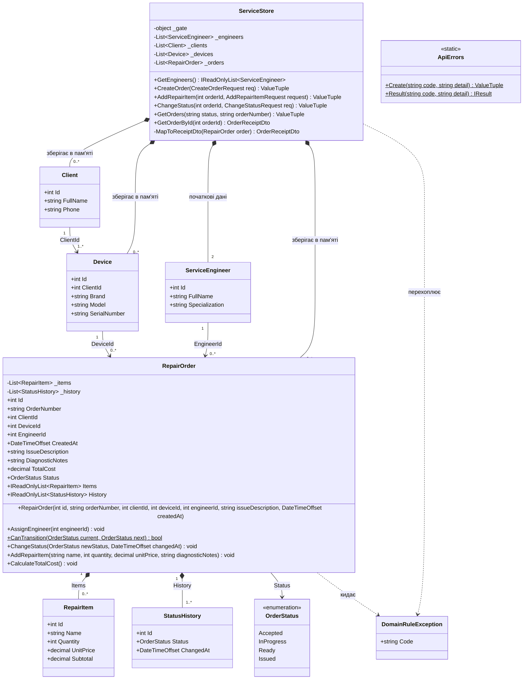

# Моделі фактичної реалізації та протокол приймання (ServiceCenter v1.0.0)

Документ доповнює базову лінію ЛР №3 (`requirements-baseline-v1.0`: `requirements.md`, `use-cases.md`, `design.md`, `implementation-plan.md`, `model/`). Самі документи базової лінії в ЛР №4 не змінюються. Тут зафіксовано, як їх реалізовано в коді і чим реалізація відрізняється від проєкту.

> **Після спринту S1 (ЛР №5).** Розділи 1, 3 і 4 описують випуск v1.0.0. У S1 `ServiceStore` замінено контрактом `IOrderRepository` з двома реалізаціями: `InMemoryOrderRepository` (колишній `ServiceStore`, використовується модульними тестами) і `SqliteOrderRepository` (EF Core + SQLite, основне сховище сервера). Тести `ServiceStoreTests` перейменовано на `InMemoryOrderRepositoryTests`, назви тестових методів збережено. Модель збережуваних даних — [`design.md`, розд. 6](design.md), план і результати спринту — [`sprints/s1.md`](sprints/s1.md).

## 1. Командна діаграма класів фактичної реалізації

Діаграма відображає фактично реалізовані класи предметної області (`src/ServiceCenter.Api/Models/`), сховище даних у пам'яті серверного процесу (`ServiceStore`) та інфраструктурний маппер помилок (`ApiErrors`).

Маршрути `Program.cs` (Minimal API) викликають методи `ServiceStore` і перетворюють код відмови на HTTP-відповідь через `ApiErrors`. Ці виклики для кожного сценарію показано на діаграмах послідовності в `docs/models/sequences/` ([UC-01](models/sequences/UC-01.md), [UC-02](models/sequences/UC-02.md), [UC-03](models/sequences/UC-03.md), [UC-04](models/sequences/UC-04.md)).

---

## 2. Порівняння проєктної моделі (ЛР №3) та фактичної реалізації (ЛР №4)

| Елемент | Проєктна модель / план ЛР №3 | Фактична реалізація (ЛР №4) | Причина / висновок |
| :--- | :--- | :--- | :--- |
| **Зв'язки між сутностями** (`Client`, `Device`, `RepairOrder`, `ServiceEngineer`) | Асоціації з кратностями `1`, `1..*`, `0..*` без полів ідентифікаторів | Поля зовнішніх ключів `Device.ClientId`, `RepairOrder.ClientId`, `RepairOrder.DeviceId`, `RepairOrder.EngineerId` (`int`) | Асоціації реалізовано через ідентифікатори, бо сутності зберігаються в окремих колекціях `List<T>` у `ServiceStore`; це також уникає циклічних посилань при JSON-серіалізації. Кратності збережено на рівні моделі. У v1.0 кожне нове замовлення створює новий запис `Client` і `Device` (пошуку наявного клієнта немає). |
| **Вкладені колекції замовлення** (`RepairItem`, `StatusHistory`) | Композиція `RepairOrder` → `RepairItem` (`0..*`) та `StatusHistory` (`1..*`) | Приватні `List<>` у `RepairOrder`, назовні лише `IReadOnlyList<> Items` / `History` | Відповідає проєктному наміру. Позиції та історію змінюють тільки методи агрегата, тож обійти правила ззовні не можна. |
| **Подання дати і часу** (`CreatedAt`, `ChangedAt`) | `DateTime` | `DateTimeOffset` (UTC) | Однозначне подання часової зони при передачі через HTTP/JSON. |
| **Методи та правила `RepairOrder`** | `AssignEngineer(engineer)`, `ChangeStatus(newStatus)`, `AddRepairItem(...)`, `CalculateTotalCost()`; план ЛР №3 (етап 1.3): правила FR-03 і FR-04 — усередині `RepairOrder` | Конструктор створює замовлення в `Accepted` з першим записом історії; `ChangeStatus` перевіряє `CanTransition` і блокування після `Issued`; `AddRepairItem` перевіряє назву, кількість, ціну та статус `InProgress`; порушення → `DomainRuleException(code)` | Відповідає плану ЛР №3. Додано статичний `CanTransition` (таблиця переходів із `state-machine.svg`) і параметр `diagnosticNotes`, щоб діагноз і позиція фіксувалися однією атомарною операцією. `ServiceStore` лише знаходить замовлення та перетворює виняток на код відмови. |
| **Зберігання даних у v1.0.0** | SRS (Scope, AC-07) і план (етап 2.1): БД SQLite «або репозиторій» | `ServiceStore` (singleton) на базі `List<T>`, узгодження доступу через `lock (_gate)` | Завдання ЛР №4 вимагає для першої версії зберігання в пам'яті серверного процесу. Дані доступні між запитами, але очищуються після перезапуску (див. README і примітки до випуску). Перехід на SQLite лишається на наступні версії. **Оновлення (ЛР №5, спринт S1):** сховище винесено за контракт `IOrderRepository`, основна реалізація — `SqliteOrderRepository` (EF Core + SQLite, міграція `InitialCreate`); дані зберігаються після перезапуску. Модель даних — `docs/design.md`, розділ 6. |
| **Користувацький інтерфейс** | План (етап 3): таблиця, фільтр і форми в `ServiceCenter.Client` | Таблиця, фільтр, форма реєстрації та картка замовлення — у вебінтерфейсі `src/ServiceCenter.Api/wwwroot/index.html`; `ServiceCenter.Client` — консольний клієнт, що проганяє контрольний сценарій приймання | Вебсторінка, яку роздає сам сервер, не потребує окремого UI-проєкту. Консольний клієнт використано для відтворюваної перевірки взаємодії клієнт–сервер. |
| **Архітектура та технології** | ЛР №1 (концепція, оцінка здійсненності): монолітний вебзастосунок на ASP.NET Core MVC / Blazor із серверним рендерингом (Razor Pages / Blazor Server) замість окремого REST API та JS-фронтенду; EF Core, SQLite, стилізація Bootstrap | Моноліт ASP.NET Core: HTTP API на Minimal API (`Program.cs`) і вебсторінка `wwwroot/index.html`, яку роздає той самий сервер (Bootstrap — стилі, вбудований JavaScript — запити `fetch` до API); консольний клієнт `ServiceCenter.Client`. Дані — SQLite через EF Core (`SqliteOrderRepository`, з ЛР №5, спринт S1) | Завдання ЛР №4 вимагає окремих серверної та клієнтської частин, які обмінюються даними через HTTP API у форматі JSON, тому сервер реалізовано як API, а не як серверний рендеринг. Щоб уникнути подвійної роботи, якої застерігала оцінка здійсненності ЛР №1, окремого фронтенд-проєкту немає: вебсторінку роздає той самий сервер. Застосунок лишається монолітом (один процес, одне розгортання), Bootstrap використано, як заплановано. EF Core і SQLite, перенесені у v1.0.0 на наступну версію, впроваджено в спринті S1 (ЛР №5). |
| **Вибір майстра** | ЛР №1 (Таблиця 3) і SRS (Scope): «Картка замовлення: інтерфейс вибору майстра…» | Інженера обирають у формі реєстрації (`engineerId` у `POST /api/orders`, список із `GET /api/engineers`); картка замовлення показує призначеного майстра. Операції перепризначення в API немає: `RepairOrder.AssignEngineer` викликається лише з конструктора | Вибір майстра під час реєстрації задано в UC-01 (крок 3) і AC-02 («при виборі інженера він закріплюється за карткою замовлення»), і його реалізовано. Зміну майстра вже зареєстрованого замовлення не описано в жодному сценарії чи критерії приймання v1.0, тому її не реалізовано; це кандидат у беклог продукту. |
| **Потреби керівника та контроль гарантій** | ЛР №1 (Таблиця 1, концепція): керівнику потрібні зведені дані про навантаження інженерів, виручку й середню тривалість ремонту; концепція згадує контроль гарантійних зобов'язань | Керівник переглядає та фільтрує замовлення (UC-04); звітів, аналітики й обліку гарантійних термінів немає | Ці функції не входять до меж v1.0 ні в ЛР №1 (Таблиця 3), ні в SRS; оцінка здійсненності ЛР №1 застерігає, що надлишкові форми аналітики порушать графік. Історія статусів і позиції ремонту зберігаються, тож дані для таких звітів накопичуються; функції лишаються кандидатами в беклог продукту. |

---

## 3. Зіставлення з діаграмами діяльності ЛР №3

| Діаграма | Крок / розгалуження на діаграмі | Фактична поведінка коду | Висновок |
| :--- | :--- | :--- | :--- |
| `activity-uc-01.md` | `ValidateFields` → A1 «Вивести повідомлення про пропущені поля» | `400 invalid_request`, повідомлення містить перелік пропущених полів («Пропущено: ПІБ клієнта, …») | Відповідає. |
| `activity-uc-01.md` | `CheckActiveOrder` → A2 «Блокувати дублікат і показати номер активного замовлення» | `409 duplicate_active_order`, повідомлення містить номер і статус активного замовлення | Відповідає. |
| `activity-uc-01.md` | Немає розгалуження для неіснуючого інженера | `404 engineer_not_found` | Технічна перевірка цілісності даних на межі API: користувач веб-форми обирає інженера зі списку `GET /api/engineers`. Діаграму не змінюємо. |
| `activity-uc-01.md` | «Зберегти в БД» | Збереження в `ServiceStore` (пам'ять процесу) | Відмінність погоджена (див. розд. 2, «Зберігання даних»). |
| `activity-uc-02.md` | `CheckIssued` → A1 «Заборонити редагування закритого замовлення» | `409 order_already_issued` | Відповідає. |
| `activity-uc-02.md` | «Встановити статус В роботі» одразу після відкриття картки | Окремий запит `PATCH /status` з `newStatus = InProgress`. Додати позицію до замовлення в `Accepted` не можна: `409 invalid_status_warning` | На діаграмі діяльності це дія користувача в картці. У коді вона реалізована як окрема операція API, бо зміна статусу має пройти правила FR-04 і потрапити в історію. Дія та її порядок збігаються. |
| `activity-uc-02.md` | `ValidateItems` «Кількість > 0 та Ціна >= 0» → A2 | `400 invalid_item_values`; додатково перевіряється непорожня назва позиції | Відповідає; перевірку назви додано для повноти даних квитанції. |
| `activity-uc-02.md` | `IsFinished` → A3 «Зберегти у статусі В роботі» / «Змінити статус на Готово» | Позиції зберігаються одразу; перехід у `Ready` — окремий `PATCH /status` | Відповідає. |

---

## 4. Протокол приймальних перевірок інтегрованої версії v1.0.0

**Перевірений коміт:** `da53ac5` · **Середовище:** .NET 9 SDK, сервер `http://localhost:5080`, клієнт `ServiceCenter.Client` (14 HTTP-запитів, кроки 1–10).

| Критерій | Початковий стан | Дія (Клієнт / Тест) | Очікуваний результат | Фактичний результат | Статус |
| :--- | :--- | :--- | :--- | :--- | :--- |
| **AC-01** | Порожній список замовлень | Крок 1: `POST /api/orders` (Петренко І. В., `iPhone 15 Pro`, `SN-IPH15-9901`, інженер ID=1) | `201 Created`; номер `SC-0001`, статус `Accepted`, `totalCost = 0`, 1 запис у `history` | `HTTP 201`; `SC-0001`, `status: "Accepted"`, `totalCost: 0`, `history: [Accepted]`, майстер `Коваленко Олександр` | Пройдено |
| **AC-02** | Активне замовлення `SC-0001` (`SN-IPH15-9901`, `Accepted`) | Крок 2: повторний `POST /api/orders` з тим самим `serialNumber` | `409 duplicate_active_order` з номером активного замовлення; кількість замовлень незмінна (1) | `HTTP 409 duplicate_active_order`, повідомлення «… Активне замовлення: SC-0001 (статус Accepted).»; `GET /api/orders` повертає рівно 1 замовлення | Пройдено |
| **AC-07** (порожні поля) | 1 замовлення `SC-0001` | Крок 3: `POST /api/orders` з порожнім `clientFullName` | `400 invalid_request` з переліком пропущених полів; замовлення не створено | `HTTP 400 invalid_request`, «… Пропущено: ПІБ клієнта.»; `GET /api/orders` повертає 1 замовлення | Пройдено |
| **AC-05** (до ремонту) | `SC-0001` у статусі `Accepted` | Крок 4: `GET /api/orders?status=Accepted&orderNumber=SC-0001` | `200`; 1 замовлення | `HTTP 200`; `[SC-0001]` | Пройдено |
| **AC-04** (перескок статусу) | `SC-0001` у статусі `Accepted` | Крок 5: `PATCH /api/orders/1/status` (`newStatus: Issued`) | `409 invalid_status_transition`; статус і історія незмінні | `HTTP 409 invalid_status_transition`; відповідь кроку 6 містить історію лише `Accepted → InProgress` (без `Issued`) | Пройдено |
| **AC-03** | `SC-0001` переведено в `InProgress` (крок 6, `HTTP 200`) | Кроки 6–7: дві позиції `8500` і `1200` грн, потім позиція з `unitPrice = -500` | Перші дві: `200`, `totalCost = 8500`, потім `9700`. Третя: `400 invalid_item_values`, сума `9700` | `HTTP 200` (`8500`), `HTTP 200` (`9700`); `HTTP 400 invalid_item_values`, `totalCost` лишився `9700`, позицій — 2 | Пройдено |
| **AC-04** (після видачі) | Кроки 8: `Ready` → `Issued` (`HTTP 200`, `HTTP 200`) | Крок 9: `POST /api/orders/1/items` для закритого замовлення | `409 order_already_issued`; позиції й сума незмінні | `HTTP 409 order_already_issued`; на кроці 10 — 2 позиції, `9700` | Пройдено |
| **AC-05** (квитанція) | `SC-0001` у статусі `Issued`, `totalCost = 9700` | Крок 10: `GET /api/orders?status=Issued&orderNumber=SC-0001` | `200`; 1 квитанція з 2 позиціями та 4 записами історії | `HTTP 200`; `SC-0001`, 2 позиції, `history: Accepted, InProgress, Ready, Issued` | Пройдено |
| **AC-06** | Сервер запущено, ≈50 замовлень | 100 запитів (`GET /api/orders` з фільтром і `POST /api/orders`), час `curl time_total` | 95% запитів ≤ 2000 мс | Медіана `0,9 мс`, p95 `2,4 мс`, максимум `4,9 мс` | Пройдено |
| **AC-07** (некоректне тіло) | Сервер у режимі `Production` (як у пакеті випуску) | `POST /api/orders` з тілом `{bad`; `POST /items` з `quantity: "abc"`; `PATCH /status` без тіла | `400 invalid_request` з українським повідомленням, без стектрейсу; дані незмінні | `HTTP 400 {"code":"invalid_request","message":"Некоректний формат тіла запиту."}` для всіх трьох; сервер продовжує роботу (`/health` → 200) | Пройдено |
| **Модульні тести** | — | `dotnet test ServiceCenter.sln` (`ServiceStoreTests`, AC-01–AC-05, AC-07) | 6/6 пройдено | 6/6 Passed | Пройдено |
| **Межа збереження v1.0** | У пам'яті сервера є замовлення `SC-0001` | Перезапуск `ServiceCenter.Api` та повторний `GET /api/orders` | Робочі замовлення очищені (`[]`), список інженерів відновлено до початкового | Після перезапуску `GET /api/orders` повертає `[]`, `GET /api/engineers` — 2 інженери | Пройдено |

---
