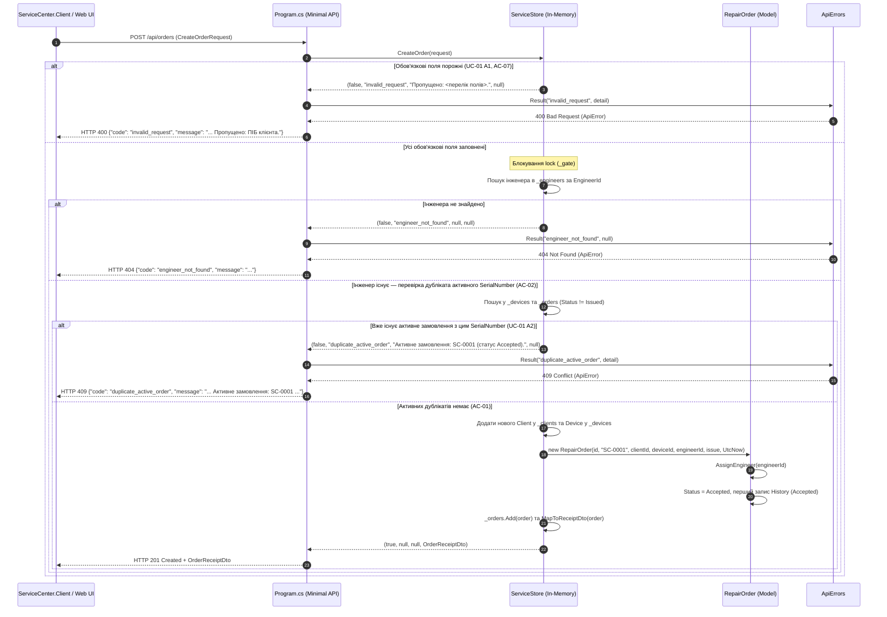
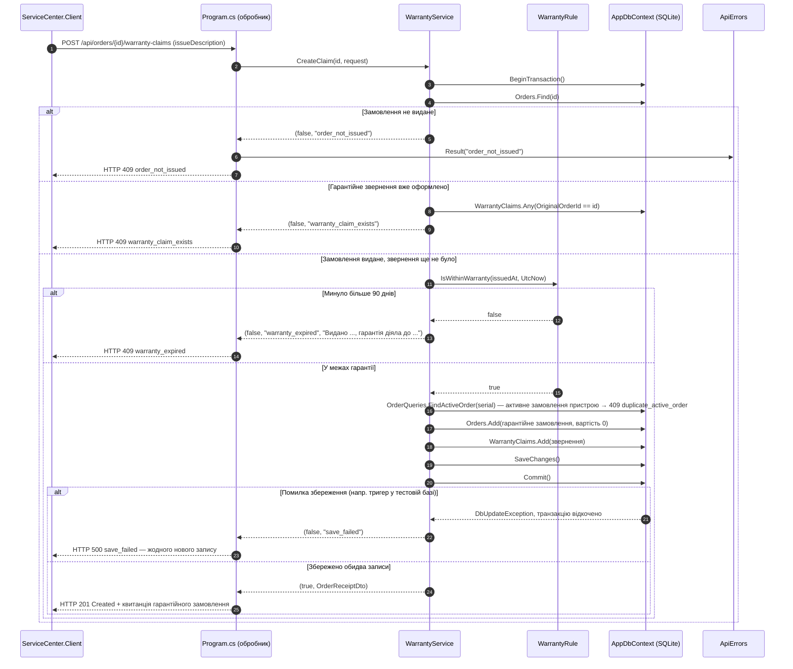

# Діаграма послідовності фактичної реалізації UC-01: Реєстрація замовлення на ремонт та призначення інженера

**Виконавець:** Лавренюк Серафим  
**Перевіряльниця діаграми:** Головань Євгенія  
**Пов'язані вимоги та критерії:** `FR-01`, `FR-02`, `AC-01`, `AC-02`, `AC-07`  
**Реалізовані компоненти в коді:**
* Клієнтський виклик: `src/ServiceCenter.Client/Program.cs` (кроки 1–3, `SendAsync(HttpMethod.Post, "/api/orders", ...)`) та веб-форма `src/ServiceCenter.Api/wwwroot/index.html`
* Серверний маршрут: `src/ServiceCenter.Api/Program.cs` (`app.MapPost("/api/orders", ...)`)
* Сховище в пам'яті: `src/ServiceCenter.Api/Services/ServiceStore.cs` (`CreateOrder`)
* Після спринту S1 (ЛР №5) ті самі виклики виконує реалізація контракту `IOrderRepository`: `SqliteOrderRepository` (`src/ServiceCenter.Api/Data/`) на сервері або `InMemoryOrderRepository` (колишній `ServiceStore`) у модульних тестах; послідовність перевірок і коди відповідей не змінилися, а в `SqliteOrderRepository` операції зміни виконуються в транзакції бази.
* Предметна модель: `src/ServiceCenter.Api/Models/RepairOrder.cs` (конструктор, `AssignEngineer`)
* Формування відповідей про відмову: `src/ServiceCenter.Api/Infrastructure/ApiErrors.cs` (`Result(code, detail)`)

**Відповідність коду:** у гілках відмови `Client`, `Device` і `RepairOrder` не створюються та не додаються до колекцій. Тому після відмови `GET /api/orders` повертає незмінний список (крок «Перевірка стану після відмов» клієнта).

## Спринт S2: гарантійне звернення за виданим замовленням

**Пов'язана історія:** «Гарантійне звернення» (S2).  
**Реалізовані компоненти в коді:**
* Клієнтський виклик: `src/ServiceCenter.Client/Program.cs` (кроки 14–17)
* Обробник: `src/ServiceCenter.Api/Program.cs` (`app.MapPost("/api/orders/{id:int}/warranty-claims", ...)`)
* Прикладна служба: `src/ServiceCenter.Api/Services/WarrantyService.cs` (`CreateClaim`), контекст отримує через конструктор
* Предметне правило: `src/ServiceCenter.Api/Rules/WarrantyRule.cs` (`IsWithinWarranty`)
* Доступ до даних: `src/ServiceCenter.Api/Data/AppDbContext.cs` (`Orders`, `WarrantyClaims`, `SaveChanges`)

**Відповідність коду:** правило гарантійного терміну не залежить від HTTP і бази — служба передає йому дати видачі та звернення. Нове замовлення і запис `WarrantyClaims` зберігаються одним `SaveChanges` у транзакції, тому в разі помилки не залишається жодного з них.
