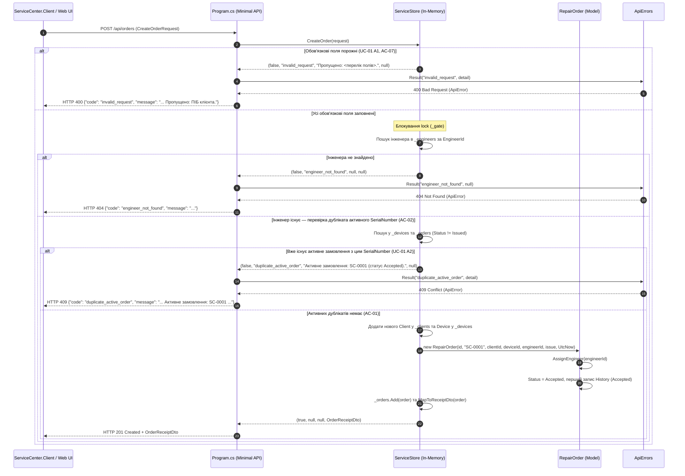

# Діаграма послідовності фактичної реалізації UC-01: Реєстрація замовлення на ремонт та призначення інженера

**Виконавець:** Лавренюк Серафим  
**Перевіряльниця діаграми:** Головань Євгенія  
**Пов'язані вимоги та критерії:** `FR-01`, `FR-02`, `AC-01`, `AC-02`, `AC-07`  
**Реалізовані компоненти в коді:**
* Клієнтський виклик: `src/ServiceCenter.Client/Program.cs` (кроки 1–3, `SendAsync(HttpMethod.Post, "/api/orders", ...)`) та веб-форма `src/ServiceCenter.Api/wwwroot/index.html`
* Серверний маршрут: `src/ServiceCenter.Api/Program.cs` (`app.MapPost("/api/orders", ...)`)
* Сховище в пам'яті: `src/ServiceCenter.Api/Services/ServiceStore.cs` (`CreateOrder`)
* Предметна модель: `src/ServiceCenter.Api/Models/RepairOrder.cs` (конструктор, `AssignEngineer`)
* Формування відповідей про відмову: `src/ServiceCenter.Api/Infrastructure/ApiErrors.cs` (`Result(code, detail)`)

**Відповідність коду:** у гілках відмови `Client`, `Device` і `RepairOrder` не створюються та не додаються до колекцій. Тому після відмови `GET /api/orders` повертає незмінний список (крок «Перевірка стану після відмов» клієнта).
