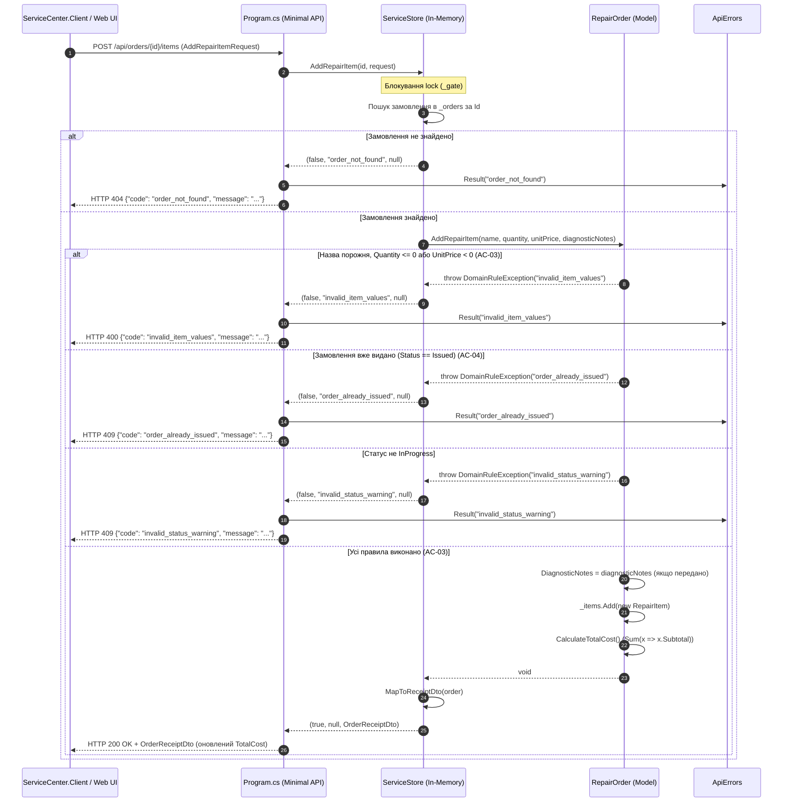

# Діаграма послідовності фактичної реалізації UC-02: Фіксація результатів діагностики та додавання робіт

**Виконавиця:** Головань Євгенія  
**Перевіряльник діаграми:** Лавренюк Серафим  
**Пов'язані вимоги та критерії:** `FR-03`, `FR-04`, `AC-03`, `AC-04`, `AC-07`  
**Реалізовані компоненти в коді:**
* Клієнтський виклик: `src/ServiceCenter.Client/Program.cs` (кроки 6, 7, 9: `POST /api/orders/{id}/items`) та картка замовлення в `wwwroot/index.html`
* Серверний маршрут: `src/ServiceCenter.Api/Program.cs` (`MapPost("/api/orders/{id:int}/items")`)
* Сховище в пам'яті: `src/ServiceCenter.Api/Services/ServiceStore.cs` (`AddRepairItem`)
* Предметна модель: `src/ServiceCenter.Api/Models/RepairOrder.cs` (`AddRepairItem`, `CalculateTotalCost`), `DomainRuleException.cs`

Переведення замовлення в `InProgress` перед додаванням позицій виконується окремим запитом `PATCH /api/orders/{id}/status` (див. [UC-03](UC-03.md)).

**Відповідність коду:** `RepairOrder.AddRepairItem` перевіряє всі правила до зміни стану. Тому при відмові ні `DiagnosticNotes`, ні `Items`, ні `TotalCost` не змінюються (у клієнті після кроку 7 сума лишається `9700`).
