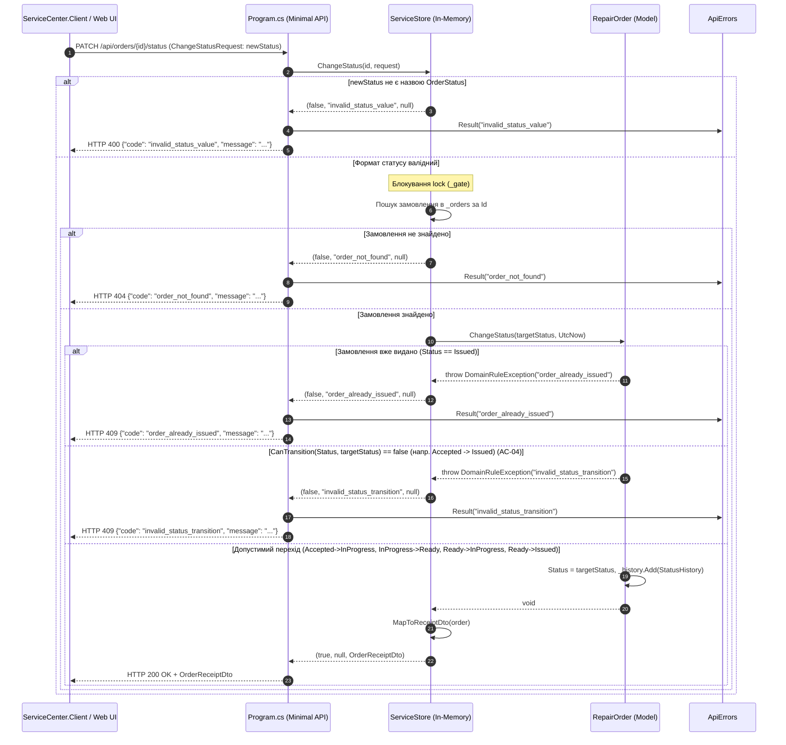

# Діаграма послідовності фактичної реалізації UC-03: Зміна статусу замовлення та видача клієнту

**Виконавиця:** Головань Євгенія  
**Перевіряльник діаграми:** Лавренюк Серафим  
**Пов'язані вимоги та критерії:** `FR-04`, `AC-04`  
**Реалізовані компоненти в коді:**
* Клієнтський виклик: `src/ServiceCenter.Client/Program.cs` (кроки 5, 6, 8: `PATCH /api/orders/{id}/status` з тілом `{ "newStatus": "..." }`) та кнопки в картці замовлення `wwwroot/index.html`
* Серверний маршрут: `src/ServiceCenter.Api/Program.cs` (`MapPatch("/api/orders/{id:int}/status")`)
* Сховище в пам'яті: `src/ServiceCenter.Api/Services/ServiceStore.cs` (`ChangeStatus`)
* Предметна модель: `src/ServiceCenter.Api/Models/RepairOrder.cs` (`ChangeStatus`, `CanTransition`), `DomainRuleException.cs`

**Відповідність коду:** перехід `Ready -> InProgress` відповідає переходу «Виявлено додаткову несправність» на `state-machine.svg` (ЛР №3). Інших повернень назад немає.
