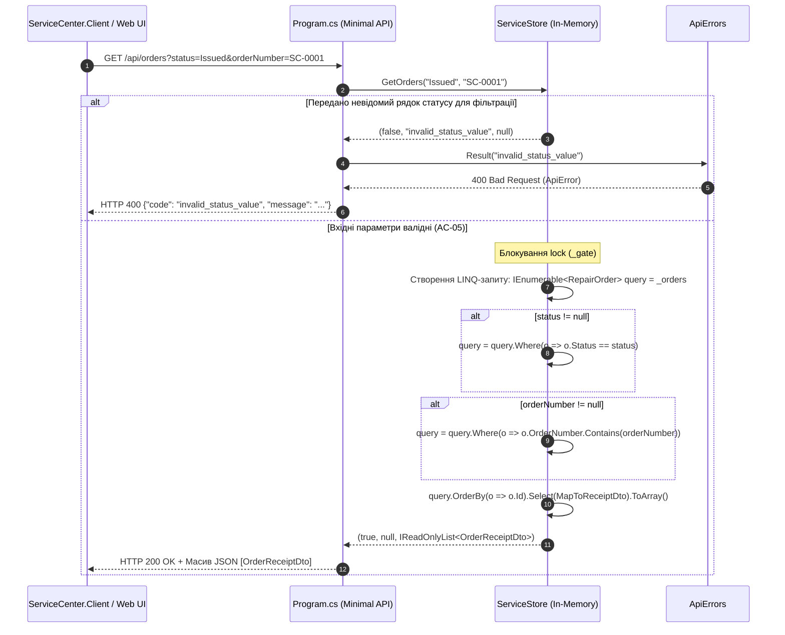

# Діаграма послідовності фактичної реалізації UC-04: Фільтрація, пошук та перегляд замовлень

**Виконавець:** Лавренюк Серафим  
**Перевіряльниця діаграми:** Головань Євгенія  
**Пов'язані вимоги та критерії:** `FR-05`, `AC-05`  
**Реалізовані компоненти в коді:**
* Клієнтський виклик: `src/ServiceCenter.Client/Program.cs` (кроки 4 і 10) та форма пошуку `wwwroot/index.html`
* Серверний маршрут: `src/ServiceCenter.Api/Program.cs` (`MapGet("/api/orders")`)
* Предметна служба та сховище в пам'яті: `src/ServiceCenter.Api/Services/ServiceStore.cs` (`GetOrders`)
* Після спринту S1 (ЛР №5) ті самі виклики виконує реалізація контракту `IOrderRepository`: `SqliteOrderRepository` (`src/ServiceCenter.Api/Data/`) на сервері або `InMemoryOrderRepository` (колишній `ServiceStore`) у модульних тестах; послідовність перевірок і коди відповідей не змінилися, а в `SqliteOrderRepository` операції зміни виконуються в транзакції бази.

